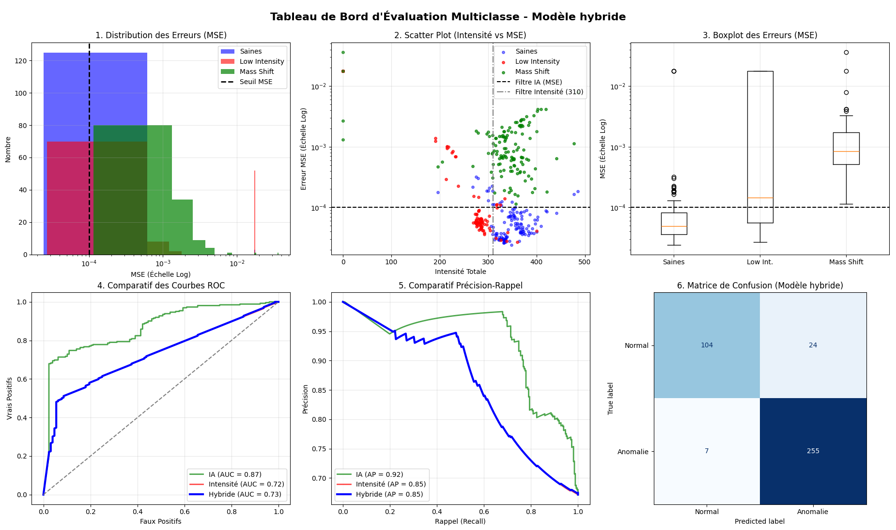

# 🔬 Cassiopée — Détection d'anomalies en spectrométrie de masse

> Un auto-encodeur convolutif qui repère automatiquement les spectres de masse défectueux dans l'analyse de l'air expiré.

Projet Cassiopée 2026 en partenariat avec l'**Hôpital Foch**.

## 🎯 Contexte

L'hôpital Foch analyse les composés organiques volatils (COV) de l'air expiré avec un spectromètre de masse **PTR-TOF-MS**, afin de diagnostiquer des maladies ou de suivre la réponse à des traitements.

Aujourd'hui, un **expert doit valider visuellement chaque acquisition**. Ce n'est pas réalisable dans les protocoles cliniques multi-centres.

**Objectif :** détecter automatiquement les spectres anormaux, et vérifier que l'IA fait mieux que les contrôles classiques (seuil d'intensité, calibration standard).

Les anomalies recherchées :

| Anomalie | Description |
|---|---|
| **Mass shift** | Le spectre est décalé en m/z (mauvaise calibration) |
| **Low intensity** | Signal global trop faible |
| **Autres** | Absence de signal, artefacts divers… |

Plus de détails sur les données : [`docs/explication_donnees.pdf`](docs/explication_donnees.pdf).

## 🧠 Méthode

L'auto-encodeur est entraîné **uniquement sur des spectres normaux**. Face à un spectre anormal, il le reconstruit mal : l'erreur de reconstruction (MSE) sert de score d'anomalie.

```
CSV bruts → Prétraitement → Auto-encodeur → Erreur de reconstruction → Normal / Anomalie
            (log1p, fenêtres m/z, scaling)   (Conv1D)                  (seuil MSE + seuil d'intensité)
```

Deux détecteurs sont évalués :
- **IA seule** : anomalie si `MSE > seuil_mse`
- **Hybride** : anomalie si `MSE > seuil_mse` **ou** intensité totale `< seuil_int`

Les mass shifts réels étant rares, des **mass shifts artificiels** sont simulés (décalage de 0,2 à 0,8 m/z) pour enrichir les tests.

## 📊 Résultats



Modèle hybride sur le jeu de test (390 spectres) :

| Métrique | Valeur |
|---|---|
| Anomalies détectées (rappel) | **255 / 262 (97 %)** |
| Spectres normaux bien classés | 104 / 128 (81 %) |
| Exactitude globale | 92 % |
| AUC — IA seule | **0,87** |
| AUC — intensité seule | 0,72 |

L'IA seule surpasse le contrôle par seuil d'intensité (AUC 0,87 contre 0,72).

## 📁 Structure du projet

```
Cassiope/
├── main.py                 # Point d'entrée : données → entraînement → évaluation
├── src/
│   ├── preprocessing.py    # Chargement CSV, alignement m/z, filtrage, scaling
│   ├── simulation.py       # Simulation de mass shifts artificiels
│   ├── models.py           # Architecture de l'auto-encodeur (Conv1D)
│   └── evaluation.py       # Métriques et graphiques (ROC, PR, confusion…)
├── config/fenetres.txt     # Fenêtres m/z conservées pour l'analyse
├── models_saved/           # Poids entraînés (.h5)
└── docs/                   # Présentation des données et figures
```

## 🚀 Utilisation

```bash
git clone <url-du-depot>
cd Cassiope
pip install -r requirements.txt
python main.py
```

- Les **poids du modèle** sont fournis dans `models_saved/` : s'ils existent, l'entraînement est sauté.
- Les **spectres sont mis en cache** (`data/processed/*.npy`) à la première lecture, ce qui accélère les exécutions suivantes.

> ⚠️ **Les données ne sont pas incluses** (données médicales de l'Hôpital Foch). Il faut les placer dans `data/` (`data/data/…`, `data/data2/…`) pour exécuter le projet, et créer le dossier `data/processed/`.

## 🛠️ Technologies

Python · TensorFlow/Keras · NumPy · pandas · SciPy · scikit-learn · Matplotlib
